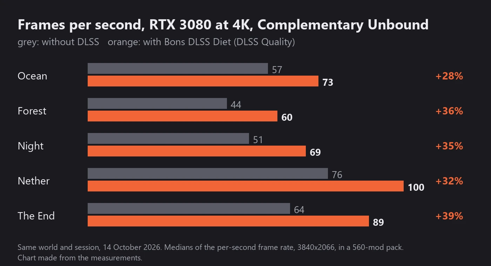
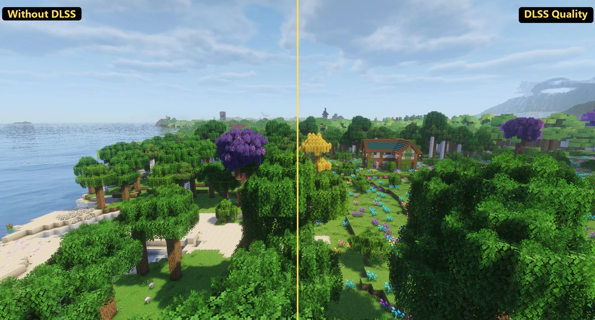

# Bons DLSS Diet

**Same picture. A third more frames.**

NVIDIA DLSS for Complementary Unbound shaders on Minecraft 1.20.1 Forge, through the Super Resolution mod.

**[Download 1.0.0](https://github.com/BonsUnleashed/bons-dlss-diet/releases/tag/v1.0.0)** for Minecraft 1.20.1 Forge · [Changelog](CHANGELOG.md) · [Build from source](BUILDING.md)

Requires Oculus with Embeddium, Super Resolution, Euphoria Patches and Complementary Unbound r5.7.1, and an NVIDIA RTX card. Client only. Free, MIT licensed. Also on CurseForge and Modrinth.

## A third more frames per second

At 4K with shaders on, the graphics card does almost all of the work per pixel. DLSS Quality draws the world at two thirds of the screen size, less than half the pixels, and builds the full frame from them. On an RTX 3080 that was 25 to 40 percent more frames per second in every scene we measured, with distant textures as sharp as before.

| Scene | Without DLSS | Bons DLSS Diet | More frames |
|---|---:|---:|---:|
| Ocean view from the shore | 57 | 73 | +28% |
| High view over the sea | 69 | 80 | +16% |
| Forest from above | 44 | 60 | +36% |
| Flying over the forest | 44 | 60 | +36% |
| Night with lights | 51 | 69 | +35% |
| Nether | 76 | 100 | +32% |
| The End | 64 | 89 | +39% |

RTX 3080, 3840x2066, Complementary Unbound r5.7.1 + Euphoria Patches 1.8.6 with Distant Horizons, in a 560-mod pack. Same world and session, 14 October 2026, medians of the per-second frame rate. Your numbers depend on your card, resolution and settings; a scene limited by the processor rather than the graphics card gains little. DLSS pays off when the graphics card is the limit: on an RTX 4090 at the pack's default settings, where the card already runs 145 FPS, DLSS Quality gave about 150, a few percent.

Want more? DLSS Quality is the default because it looks like the native frame. Super Resolution also offers Balanced and Performance: fewer rendered pixels, more frames, a little less detail. Ocean view from the shore: 59 without DLSS, 76 with Quality, 84 with Performance.

## Gets along with your other mods

Bons DLSS Diet has no mixins and changes nothing in any other mod or in the game itself. It only writes a shader pack folder. Whatever runs with Complementary Unbound today keeps running, and a mod update cannot break it.

We test it in a 560-mod pack, scene by scene, with DLSS on:

- **Create** cogs, fans and shafts turning (Flywheel instancing through Colorwheel) and **Valkyrien Skies** ships under sail.
- **Distant Horizons** LOD terrain to the horizon, **Alex's Caves** cave biomes and the Ambersol, **Cosmic Horizons** space, the Nether and the End.
- Mobs, name tags, glowing and enchanted armour, the hand, signs and item frames, tinted-glass mirrors, portals, rain and night lights.
- Mid-game actions: window resize, shader reload, shaders off and on, resource reload, third person. All behave as without DLSS.
- Alongside Fancy World Animations, Entity Model and Texture Features, Fusion connected textures and resource packs, Mekanism, Immersive Engineering, Alex's Mobs, Supplementaries and 500 more.

## How it works

It works like Euphoria Patches: the jar contains none of Complementary's code. On the first start it writes a copy of the pack you already have, named `<your pack> + DLSS`, next to the original. Pick that copy in the shader menu and you are done. The original stays untouched and your shader settings carry over.

- **Full-resolution textures.** Roof tiles, leaves, water ripples and generated normals keep the detail of a native frame. Upscaling normally loses this; here the shaders pick the texture level for your real screen size.
- **Everything else keeps working.** Reflections, depth of field, volumetric light, clouds, Distant Horizons LODs, the End and the Nether.
- **DLSS replaces the shader's TAA and FXAA.** Moving mobs, turning Create gears and a sailing Valkyrien Skies deck stay crisp.

Inside the pack: everything before the upscale draws at the render size (the buffers are sized with Super Resolution's scale factor, the vertices jittered), composite5 writes camera motion vectors, Super Resolution runs right before composite6 with the colour, depth and motion buffers, the shaders then read its full-size result, and the block-atlas samples get the mip bias and texture derivatives of a full-resolution frame. Nothing changes when Super Resolution is absent or off: the patched pack then renders exactly like the original.

## What you need

| Mod | Version | Why |
|---|---|---|
| Minecraft Java 1.20.1 with Forge | 47.4 or newer | |
| Oculus with Embeddium | 1.8.0 | runs the shaders |
| Super Resolution | 0.9.2 alpha 2 or newer | provides DLSS and fetches NVIDIA's DLSS library on first start |
| Complementary Unbound with Euphoria Patches | r5.7.1 with Euphoria Patches 1.8.6 | the shaders being patched; this exact pair is the one we test, newer pairs follow |
| An NVIDIA RTX graphics card | 20 series or newer | DLSS runs on its tensor cores |

Super Resolution also offers FSR 2 and 3 and XeSS through the same interface. We test DLSS.

## Install

1. Put `bons_dlss_diet-1.0.0.jar` in your mods folder with the mods above and start the game once.
2. Options, Video Settings, Shader Packs: choose `ComplementaryUnbound_r5.7.1 + EuphoriaPatches_1.8.6 + DLSS`.
3. In Super Resolution's settings choose DLSS and the Quality ratio (1.5). Balanced and Performance give more frames for less detail.

Client only. Nothing is needed on a server.

## Good to know

- The log says what happened: `Bons DLSS Diet: wrote "... + DLSS" from ...`, or why a pack was left alone.
- Other Complementary versions, Complementary without Euphoria Patches and Complementary Reimagined are left untouched for now; a pack the mod does not recognise is never changed.
- After a Complementary or Euphoria Patches update the generated folder is rebuilt on the next start as soon as the mod supports the new pair; until then it stays as it is.
- Preset K is the DLSS model that looked best on our RTX 3080. Super Resolution lets you try the others.
- Iris on 1.20.1 has no per-object motion vectors, so fast-moving mobs and ships carry only the camera's motion. DLSS's own history checks cover them; we saw no ghosting in our scenes.
- With the Euphoria Patcher mod 1.8.6 and Oculus 1.8.0, the plain Euphoria pack itself fails to compile unless Super Resolution is installed (final.fsh, "undefined variable _10", on every card we tried). The DLSS copy with Super Resolution works. This is not caused by this mod; if your plain pack is broken, Super Resolution fixes it as a side effect.

## Credits and licence

Complementary Shaders by EminGT ([complementary.dev](https://www.complementary.dev)) and Euphoria Patches by SpacEagle17 ([euphoriapatches.com](https://www.euphoriapatches.com)) are not included. The mod patches the copies you installed, in the way Euphoria Patches itself works, and the patched copy keeps their licence files. DLSS is NVIDIA's; [Super Resolution](https://modrinth.com/mod/superresolution) by 187J3X1 brings it into the game. See [NOTICE.md](NOTICE.md).

Created by BonsUnleashed. Developed with AI assistance. The mod's own code is released under the [MIT License](LICENSE); the source and build script come with every release.

Cover art: AI-generated promotional concept art. Modrinth icon: detail from Frank R. Paul's cover of Amazing Stories, April 1928, public domain in the United States (publication term expired); scan from the Internet Archive, cropped and resized, original colour.
